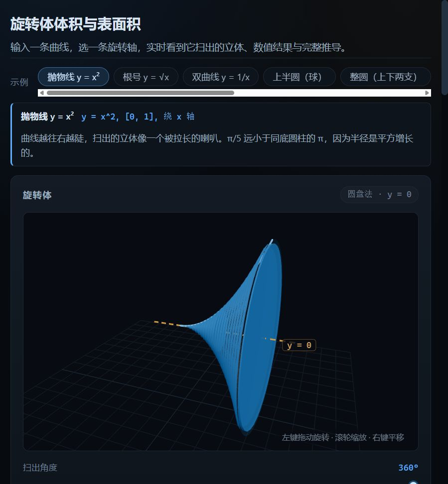
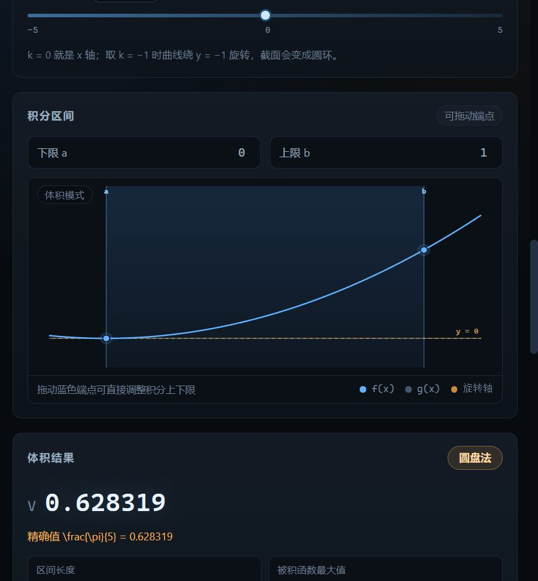
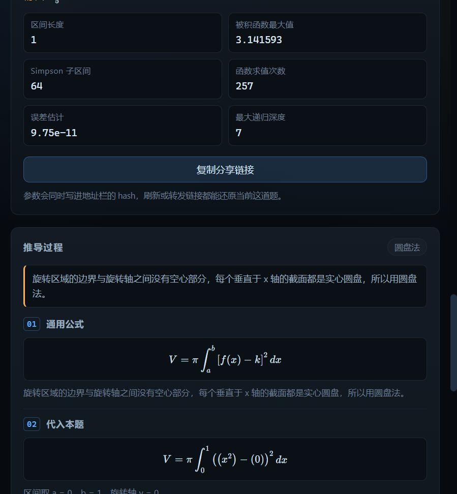

# 旋转体体积与表面积 · 交互式教学工具

一条曲线绕一条直线旋转，扫出的立体有多大、表面有多少？这个工具把「公式 — 图形 — 数值」放在同一屏里：

- 左边可交互的 3D 旋转体，右边是随输入实时变化的完整推导链。
- 所有计算都在浏览器本地完成：无后端、无数据库、无 API Key、无网络请求。

**在线演示**：<https://ss277353ss-source.github.io/solid-of-revolution/>



## 目录

- [功能一览](#功能一览)
- [截图](#截图)
- [数学原理](#数学原理)
- [数值方法](#数值方法)
- [边界情况](#边界情况)
- [本地运行](#本地运行)
- [测试与验收](#测试与验收)
- [部署到 GitHub Pages](#部署到-github-pages)
- [目录结构](#目录结构)
- [技术栈](#技术栈)

## 功能一览

**输入**

- 曲线 `y = f(x)`，支持 `sin / cos / tan / exp / log / sqrt / abs / ^ / pi / e`，由 math.js 解析。
- 下边界 `y = g(x)`：旋转区域的下边界，默认 `0` 即 x 轴。
- 旋转轴：水平轴 `y = k` 或垂直轴 `x = k`，`k` 可用滑块或输入框调整，支持 `k ≠ 0`。
- 积分上下限 `a`、`b`：可直接输入，也可以在 2D 图上拖动蓝色端点。
- 模式：体积 / 表面积；积分精度可选 `1e-6` 到 `1e-11`。

**2D 函数图像与面积**

- 三种视图随时切换：仅函数图像 / 与 x 轴围成 / 与 y 轴围成。
- 面积视图直接给曲线与坐标轴之间的区域填色，并实时显示面积数值：`S = ∫ₐᵇ |f(x)| dx`，或按单调段累加的 `S = Σ |∫ x dy|`。
- `f(x)` 不单调时会自动拆成多个单调段，分别填色、分别累加。

**3D 可视化**

- 鼠标左键旋转、滚轮缩放、右键平移。
- 扫出角度滑块：`0° → 360°`，拖动时曲面像被"扫"出来一样逐渐生成。
- 微元滑块：`n = 4 → 200`，实时显示 n 个圆盘 / 圆环 / 柱壳，n 增大时肉眼可见微元逼近真实体积。
- 可单独高亮第 n 个微元，并在 3D 中标注它的半径 r、厚度 dx / 高度 h。
- 明暗 / 线框 / 半透明三种显示模式；曲面与微元可分别开关。
- 曲线、旋转轴（虚线）与地面网格同时显示，`k ≠ 0` 的偏移一眼可见。

**推导与结果**

- KaTeX 实时渲染六步推导：通用公式 → 代入本题 → 符号求导 → 化简被积函数 → 数值结果 → 解析解。
- 自动判定并标注当前方法（圆盘法 / 圆环法 / 柱壳法）及选择理由。
- 结果面板给出体积 / 表面积、区间长度、被积函数最大值、Simpson 子区间数、求值次数、误差估计与递归深度。
- 「复制分享链接」把全部参数编码进 URL hash，刷新或转发都能还原。

**边界提示**

- 曲线在轴下方、曲线穿越旋转轴、区间内有断点、`a ≥ b`、表达式语法错误、绕垂直轴且非单调等情况都有对应的中文提示。

## 截图

| 2D 图像与区间拖拽 | 六步推导 |
| --- | --- |
|  |  |

## 数学原理

### 记号与旋转区域

- 主曲线 `y = f(x)`，下边界 `y = g(x)`（默认 `g(x) = 0`）。
- 旋转轴：水平轴 `y = k`，或垂直轴 `x = k`。
- 积分区间 `[a, b]`（`a ≥ b` 时自动交换）。

旋转的是 `f` 与 `g` 之间的区域。每个点绕轴旋转后，到轴的距离就是它扫出的圆的半径：

```
r_f(x) = |f(x) − k|,   r_g(x) = |g(x) − k|      （水平轴）
r(x)   = |x − k|                                 （垂直轴，柱壳半径）
```

### 体积

**圆盘法**（水平轴，且两条边界同在轴的一侧、内半径为 0）：

$$V = \pi\int_a^b \big[f(x)-k\big]^2\,dx$$

**圆环法**（水平轴，截面是外圆减内圆）：

$$V = \pi\int_a^b\left[\big(f(x)-k\big)^2-\big(g(x)-k\big)^2\right]dx$$

若两条边界分居轴的两侧（例如整圆 `y = ±√(1−x²)`），截面其实是实心圆盘，内半径取 0：

$$R(x)=\max\big(|f(x)-k|,\ |g(x)-k|\big),\qquad
r(x)=\begin{cases}0, & (f-k)(g-k)<0\\ \min(\cdot), & \text{否则}\end{cases}$$

**柱壳法**（垂直轴）：

$$V = 2\pi\int_a^b |x-k|\cdot|f(x)-g(x)|\,dx$$

### 表面积

表面积只统计曲线 `f(x)` 旋转生成的侧面（不含上下端面，这是教材的标准口径）。弧长微元是 `√(1 + f′(x)²) dx`：

$$S = 2\pi\int_a^b |f(x)-k|\sqrt{1+\big[f'(x)\big]^2}\,dx \qquad\text{（水平轴）}$$

$$S = 2\pi\int_a^b |x-k|\sqrt{1+\big[f'(x)\big]^2}\,dx \qquad\text{（垂直轴）}$$

**例**：`y = √(1−x²)` 在 `[−1,1]` 上，

$$S=2\pi\int_{-1}^{1}\sqrt{1-x^2}\cdot\frac{dx}{\sqrt{1-x^2}}=2\pi\cdot 2=4\pi$$

正是球面积；同一道题的体积是 `4π/3`，即球体积。

### 为什么这样选方法

| 条件 | 方法 | 理由 |
| --- | --- | --- |
| 水平轴，内半径为 0 | 圆盘法 | 截面是垂直于 x 轴的实心圆盘 |
| 水平轴，内半径 > 0 | 圆环法 | 下边界不在轴上，截面是外圆减内圆的圆环 |
| 垂直轴 | 柱壳法 | 沿 x 切成竖条，绕竖直轴卷起来是空心圆柱壳 |

## 数值方法

### 自适应 Simpson

在 `[a,b]` 上取 Simpson 公式

$$S(a,b)=\frac{b-a}{6}\Big[f(a)+4f\!\left(\tfrac{a+b}{2}\right)+f(b)\Big]$$

把区间二分后比较 `S(a,b)` 与 `S(a,m)+S(m,b)`，差值 `Δ` 对应的误差主项约为 `|Δ|/15`。若误差估计超过本层容限就继续二分，否则返回 `S(a,m)+S(m,b)+Δ/15`（Richardson 外推）。

- 容限按区间长度与二分深度逐层分配，最终误差估计是所有叶子区间 `|Δ|/15` 之和。
- 默认精度 `1e-9`，界面上可调到 `1e-11`；实测误差估计普遍在 `1e-11` 量级。
- 端点处导数发散的函数（如 `√(1−x²)` 在 `x = ±1`）做了端点微移保护，避免出现 `0 × ∞ = NaN`。
- 曲线穿越旋转轴、或柱壳半径在 `x = k` 处折返时，会先在零点处切分区间再分段积分，避免 `|·|` 的尖点拖慢收敛。

### 符号求导与解析解

- 求导：`math.derivative(node, 'x')`，再 `math.simplify`。若 math.js 无法符号求导（如 `abs`），自动退化为中心差分并在界面上注明。
- 解析解：math.js 没有不定积分，这里在 math.js 的 AST 上实现了积分规则，并且**必须通过数值反证**才会展示：

  1. 对得到的原函数 `F(x)` 求导；
  2. 在区间内取 7 个采样点比较 `F′(x)` 与被积函数，相对误差需小于 `1e-6`；
  3. 再用 `F(b) − F(a)` 与数值积分结果比对，误差超过 `1e-6` 就丢弃。

  任何一步不通过都静默跳过第六步，绝不展示可能错误的"精确解"。

  规则库覆盖：多项式、`1/x`、`exp / log / sqrt`、`sin / cos`（含 `sin(2x)`、`sin(πx)` 这类线性内层）、`sin² / cos² / tan²`，以及 `(sin x ± c)²` 这类可展开的平方。例如 `y = sin x` 在 `[0, π]` 上的体积会直接给出 `π²/2`，`y = x²` 绕 `y = −1` 会给出 `13π/15`。像 `sin⁴x`、`(sin x + cos x)²` 这类暂未覆盖的形式会保留数值结果，并在第六步注明"当前规则库未覆盖"。

## 边界情况

| 情况 | 处理 | 界面提示 |
| --- | --- | --- |
| `f(x)` 在区间内取负值 | 体积按 `[f(x)]²` 计算 | 提示"曲线在轴下方，已按半径绝对值处理" |
| 曲线穿越旋转轴 | 在零点处切分区间，分段积分 | 列出穿越点坐标 |
| 区间内有 NaN / Infinity / 极点 | 拒绝积分，在 2D 图上标红断点 | 提示调整区间或更换函数 |
| `a ≥ b` | 自动交换 | 提示已交换及交换后的区间 |
| 表达式非法 | 捕获 math.js 的解析错误 | 显示出错文本、插入符位置与原因 |
| 绕垂直轴且非单调 | 仍按柱壳法积分 | 提示"结果可能不直观：不同 x 处的壳会占据同一片空间" |
| 旋转轴落在旋转区域内部 | 截面按实心圆盘处理 | 提示确认几何理解 |

## 本地运行

需要 Node.js 18+（开发时使用 Node 24 / npm 11）。

```bash
cd solid-of-revolution
npm install
npm run dev
```

打开终端里输出的地址（默认 <http://localhost:5173>）。

其他命令：

```bash
npm run build     # 类型检查 + 生产构建，产物在 dist/
npm run preview   # 本地预览生产构建
npm run test      # 等价于 npx vitest run
npm run verify    # 8 条硬性验收用例
```

## 测试与验收

### 硬性验收用例

`npm run verify` 用应用真实的计算链路（解析 → 判定方法 → 自适应 Simpson）逐条断言相对误差 < `1e-6`：

| 曲线 | 区间 | 旋转轴 | 模式 | 期望值 | 实得值 | 相对误差 | 方法 | 结果 |
| --- | --- | --- | --- | --- | --- | --- | --- | --- |
| `y = x²` | `[0,1]` | x 轴 | 体积 | π/5 ≈ 0.628318531 | 0.628318531 | 0.00e+0 | 圆盘法 | PASS |
| `y = x²` | `[0,1]` | x 轴 | 表面积 | ≈ 3.809729705 | 3.809729705 | 6.99e-16 | 圆盘法 | PASS |
| `y = √(1−x²)` | `[−1,1]` | x 轴 | 体积 | 4π/3 ≈ 4.188790205 | 4.188790205 | 2.12e-16 | 圆盘法 | PASS |
| `y = √(1−x²)` | `[−1,1]` | x 轴 | 表面积 | 4π ≈ 12.566370614 | 12.566370614 | 0.00e+0 | 圆盘法 | PASS |
| `y = x` | `[0,1]` | x 轴 | 体积 | π/3 ≈ 1.047197551 | 1.047197551 | 0.00e+0 | 圆盘法 | PASS |
| `y = x` | `[0,1]` | x 轴 | 表面积 | π√2 ≈ 4.442882938 | 4.442882938 | 0.00e+0 | 圆盘法 | PASS |
| `y = 1/x` | `[1,2]` | x 轴 | 体积 | π/2 ≈ 1.570796327 | 1.570796327 | 0.00e+0 | 圆盘法 | PASS |
| `y = x²` | `[0,1]` | y = −1 | 体积 | 13π/15 ≈ 2.722713633 | 2.722713633 | 3.26e-16 | 圆环法 | PASS |

表面积理论值说明：`π(18√5 − asinh 2)/32 ≈ 3.809729705`。

三角函数的额外自测（同样断言相对误差 < `1e-6`）：

| 曲线 | 区间 | 模式 | 期望值 | 实得值 | 解析解 |
| --- | --- | --- | --- | --- | --- |
| `y = sin x` | `[0, π]` | 体积 | π²/2 ≈ 4.934802201 | 4.934802201 | `π²/2` |
| `y = sin x` | `[0, π]` | 表面积 | 2π(√2 + asinh 1) ≈ 14.423599448 | 14.423599448 | — |
| `y = cos x` | `[0, π/2]` | 体积 | π²/4 ≈ 2.467401100 | 2.467401100 | `π²/4` |
| `y = sin(2x)` | `[0, π/2]` | 体积 | π²/4 ≈ 2.467401100 | 2.467401100 | `π²/4` |
| `y = sin(πx)` | `[0, 1]` | 体积 | π/2 ≈ 1.570796327 | 1.570796327 | `π/2` |
| `y = tan x` | `[0, π/4]` | 体积 | π − π²/4 ≈ 0.674191553 | 0.674191553 | `π − π²/4` |
| `y = sin x` | `[0, π]`，绕 `y = −1` | 体积 | 4π + π²/2 ≈ 17.501172815 | 17.501172815 | `4π + π²/2` |

验收日志（`npm run verify`）：

```text
旋转体计算验收（相对误差阈值 1e-6）
============================================================================================
y = x²  [0,1]  绕 x 轴  体积           | 期望 0.628318531   | 实得 0.628318531   | 相对误差 0.00e+0 | 方法 圆盘法    | 误差估计 6.10e-12 | PASS
y = x²  [0,1]  绕 x 轴  表面积          | 期望 3.809729705   | 实得 3.809729705   | 相对误差 6.99e-16 | 方法 圆盘法    | 误差估计 3.11e-12 | PASS
y = √(1−x²)  [−1,1]  绕 x 轴  体积     | 期望 4.188790205   | 实得 4.188790205   | 相对误差 2.12e-16 | 方法 圆盘法    | 误差估计 5.92e-17 | PASS
y = √(1−x²)  [−1,1]  绕 x 轴  表面积    | 期望 12.566370614  | 实得 12.566370614  | 相对误差 0.00e+0 | 方法 圆盘法    | 误差估计 0.00e+0 | PASS
y = x  [0,1]  绕 x 轴  体积            | 期望 1.047197551   | 实得 1.047197551   | 相对误差 0.00e+0 | 方法 圆盘法    | 误差估计 0.00e+0 | PASS
y = x  [0,1]  绕 x 轴  表面积           | 期望 4.442882938   | 实得 4.442882938   | 相对误差 0.00e+0 | 方法 圆盘法    | 误差估计 0.00e+0 | PASS
y = 1/x  [1,2]  绕 x 轴  体积          | 期望 1.570796327   | 实得 1.570796327   | 相对误差 0.00e+0 | 方法 圆盘法    | 误差估计 3.23e-12 | PASS
y = x²  [0,1]  绕 y = −1  体积        | 期望 2.722713633   | 实得 2.722713633   | 相对误差 3.26e-16 | 方法 圆环法    | 误差估计 6.10e-12 | PASS
============================================================================================

全部 8 个用例通过（相对误差均 < 1e-6）
```

### 单元测试

`npx vitest run`：**6 个测试文件、69 个用例全部通过**。

```text
✓ src/math/integrate.test.ts (9 tests)
✓ src/math/solids.test.ts (14 tests)
✓ src/math/parse.test.ts (14 tests)
✓ src/math/area.test.ts (7 tests)
✓ src/math/symbolic.test.ts (10 tests)
✓ src/math/analyze.test.ts (15 tests)

Test Files  6 passed (6)
     Tests  69 passed (69)
```

覆盖内容：Simpson 的收敛性与误差估计、`a > b` 与空区间、NaN 抛错、尖点函数；解析、求导、复数结果、未知变量、无参函数（`sin()`）拦截；与 x 轴 / y 轴围成面积（含负值取绝对值、端点导数发散、非单调分段累加）；圆盘 / 圆环判定、偏移轴、端点保护、微元切分；多项式与三角函数（含平方、线性内层、可展开平方）的解析解与"无法求解返回 null"；以及 `analyze` 的全部边界分支与三角函数数值。


## 目录结构

```text
solid-of-revolution/
├─ .github/workflows/deploy.yml   # GitHub Pages 自动部署
├─ docs/                          # README 截图
├─ scripts/verify.ts              # 8 条硬性验收用例
├─ src/
│  ├─ components/                 # 界面组件
│  │  ├─ CurveInputs.tsx          # 曲线、下边界、模式、精度
│  │  ├─ AxisControls.tsx         # 旋转轴与 k
│  │  ├─ RangeControls.tsx        # 上下限输入
│  │  ├─ Plot2D.tsx               # 2D 图像、面积视图 + 可拖拽端点 + 断点标红
│  │  ├─ Scene3D.tsx              # three.js 旋转体、扫角、微元、标注
│  │  ├─ SceneControls.tsx        # 扫角 / n / 高亮 / 显示模式
│  │  ├─ DerivationPanel.tsx      # KaTeX 六步推导
│  │  ├─ ResultPanel.tsx          # 数值结果与分享链接
│  │  ├─ WarningList.tsx          # 检查与提示
│  │  ├─ PresetList.tsx           # 示例预设
│  │  ├─ NumberField.tsx          # 可自由输入的数字框
│  │  └─ Tex.tsx                  # KaTeX 渲染封装
│  ├─ math/                       # 数学内核（全部带单元测试）
│  │  ├─ integrate.ts             # 自适应 Simpson
│  │  ├─ area.ts                  # 与 x / y 轴围成的面积
│  │  ├─ parse.ts                 # 解析、求导、数值差分
│  │  ├─ geometry.ts              # 零点、断点、单调性、采样
│  │  ├─ solids.ts                # 半径、体积/表面积被积函数、微元
│  │  ├─ symbolic.ts              # 规则式符号积分 + 数值反证
│  │  ├─ analyze.ts               # 串联成完整分析结果
│  │  └─ *.test.ts                # Vitest 单元测试
│  ├─ presets/index.ts            # 示例预设与直觉说明
│  ├─ utils/share.ts              # URL hash 编解码
│  ├─ App.tsx, main.tsx, styles.css
│  └─ types.ts
├─ index.html
├─ vite.config.ts
├─ package.json
├─ LICENSE
├─ .editorconfig
└─ .gitignore
```

## 技术栈

Vite 5 · React 18 · TypeScript 5 · math.js 13 · three.js 0.169 · @react-three/fiber 8 · @react-three/drei 9 · KaTeX 0.16 · Vitest 2

所有依赖都通过 npm 本地打包（KaTeX 字体也会被打进 `dist/assets`），页面运行时不请求任何 CDN 或外部接口。

## 已知取舍

- **表面积只算曲线 `f` 旋转出的侧面**，不含 `g` 与上下端面。这是教材对"旋转曲面面积"的标准定义，也与验收表一致。
- **解析解是尽力而为**：多项式与常见初等函数（含 `sin / cos`、`sin² / cos² / tan²`、线性内层）可以给出精确表达式，`∫x²√(1+4x²)dx`、`sin⁴x` 这类会被跳过第六步，只保留数值结果。
- **端点整齐时保留符号形式**：端点为整数、半整数或 `π/4` 的有理倍数时，结果会写成 `π²/2`、`13π/15` 这样的精确形式；拖动端点得到任意小数时改用小数系数，避免出现 `16807/100000` 这种难以阅读的大分数。
- **三角函数全部走同一套数值积分**：`sin / cos / tan / sec / csc / cot / asin / acos / atan` 等 math.js 支持的写法都能解析、求导与绘制；其中 `tan` 的极点会被断点检测标红。

## 许可证

[MIT](LICENSE)
